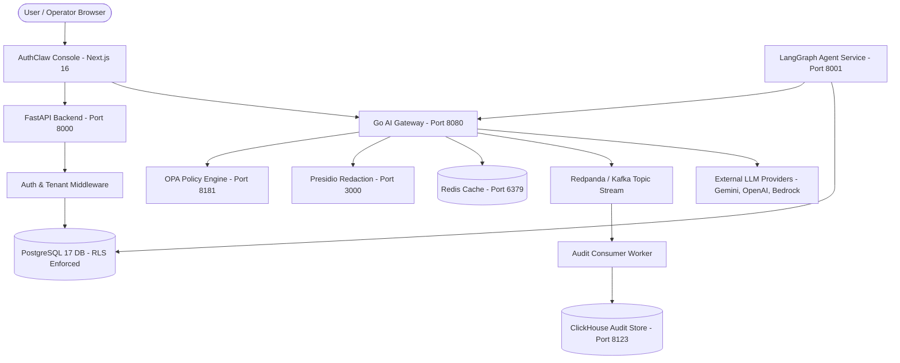

# AuthClaw Phase 0 Investigation

**Document Version:** 1.0.0  
**Project:** AuthClaw Existing Architecture & ITSM Reuse Analysis  
**Investigation Date:** September 3, 2026  
**Status:** Complete (Phase 0 Investigation Only — No Code Modifications or ITSM Implementation Performed)

---

## 1. Executive Summary

AuthClaw is a consolidated, enterprise-grade AI security, compliance, and governance control plane developed by **AgentsArchitects**. It combines five core functional subsystems into a unified monorepo:

1. **Control Plane Backend (FastAPI / Python 3.14)**: Handles user authentication, tenant management, RBAC, API keys, OIDC SSO, compliance scoring, and policy definitions.
2. **AI Provider Gateway (Go 1.26 / Chi)**: High-performance reverse proxy that routes LLM requests (OpenAI, Anthropic, Gemini, Azure OpenAI, Bedrock, Cohere), enforces rate limits, executes PII redaction via Microsoft Presidio, applies OPA policy evaluation, and streams audit logs.
3. **Operator Console (Next.js 16 / React 19 / TypeScript)**: Modern web dashboard for tenant administration, API key management, audit trail inspection, approval workflows, and compliance reporting.
4. **AI Agent Compliance Service (LangGraph / Python 3.14)**: Orchestrates agentic workflows, multi-step policy evaluation, Human-in-the-Loop (HITL) approval, regulatory RAG document processing, and risk scoring.
5. **Audit Ingestion Backbone (Kafka/Redpanda + ClickHouse)**: Asynchronous, tamper-evident audit pipeline that validates SHA-256 cryptographic hash-chains and persists append-only audit records to ClickHouse for analytics and SOC 2 / GDPR compliance readiness.

This document presents the detailed empirical investigation of the existing AuthClaw repository to establish what capabilities **AuthClaw ITSM** can directly reuse versus what ITSM must build from scratch.

---

## 2. Project Structure

### Repository Tree (Key Directories & Files)

```
AuthClaw_Align-master/AuthClaw_Align-master/
├── backend/                              # FastAPI Control Plane
│   ├── alembic/                          # Alembic database migration scripts (versions 001..042)
│   │   └── versions/                     # Schema DDLs & RLS policy definitions
│   ├── app/                              # Backend application code
│   │   ├── api/v1/endpoints/             # 25 API endpoint modules (auth, tenants, apikeys, workflows, etc.)
│   │   ├── core/                         # Core security (auth, crypto, OIDC, startup checks)
│   │   ├── db/                           # SQLAlchemy models, session context & RLS bindings
│   │   └── services/                     # Business logic services (audit, policy engine, compliance)
│   ├── main.py                           # FastAPI application entrypoint & middleware mounting
│   ├── requirements.in                   # Direct Python dependency definitions
│   └── requirements.txt                  # Hash-locked Python dependency locks
├── console/                              # Operator Web Console
│   ├── src/app/                          # Next.js App Router (Console pages & BFF API proxy routes)
│   │   ├── (console)/                    # Operator dashboard views (overview, audit, policies, agent, etc.)
│   │   ├── (marketing)/                  # Marketing & public landing pages
│   │   └── api/                          # Next.js BFF API proxy routes ([...path], auth, workflows, etc.)
│   ├── src/components/                   # React UI components (Shadcn UI, Radix primitives)
│   ├── src/lib/                          # Frontend API client utilities & auth helpers
│   ├── package.json                      # Node.js dependencies & scripts
│   └── next.config.ts                    # Next.js runtime configuration
├── gateway/                              # High-Performance AI Provider Gateway
│   ├── main.go                           # Chi router entrypoint, health checks, metrics
│   ├── proxy.go                          # Reverse proxy for OpenAI, Anthropic, Gemini, Bedrock, Cohere
│   ├── auth.go                           # Bearer token & API key verification via PostgreSQL authn functions
│   ├── policy.go                         # Local & Open Policy Agent (OPA) decision evaluation
│   ├── redact.go                         # Presidio & regex PII redaction engine
│   ├── audit.go                          # Kafka producer & local outbox fallback for audit streaming
│   ├── rate_limit.go                     # Redis token bucket rate-limiting middleware
│   ├── provider_credentials.go           # Tenant provider credential resolution & KMS decryption
│   └── go.mod                            # Go module dependencies (Go 1.26)
├── audit_consumer/                       # Asynchronous Audit Ingestion Pipeline
│   ├── consumer.py                       # Kafka message consumer & hash-chain validator
│   ├── clickhouse_writer.py              # ClickHouse row inserter & duplicate detection
│   ├── hash_chain.py                     # SHA-256 cryptographic hash-chain verification
│   └── requirements.in                   # Consumer Python dependencies
├── services/agent/                       # AI Agent & Orchestration Engine
│   ├── main.py                           # Agent API entrypoint (FastAPI / Uvicorn)
│   ├── graph.py                          # LangGraph state graph workflow definition
│   ├── nodes/                            # Workflow nodes (policy, risk, approval, rag, llm, redact, audit)
│   ├── rag/                              # Regulatory RAG corpus, chunking, embeddings, vector store
│   ├── approval_store.py                 # Human-in-the-Loop (HITL) approval store & lifecycle
│   ├── policy.py                         # Agent policy evaluator
│   ├── memory.py                         # Agent conversation memory manager
│   └── state.py                          # AuthState state dictionary schema
├── infra/                                # Infrastructure as Code & Operational Policies
│   ├── terraform/                        # AWS ECS, RDS, ECR, KMS, CloudWatch terraform modules
│   ├── opa/                              # Open Policy Agent Rego policy definitions (`authclaw.rego`)
│   ├── clickhouse/                       # ClickHouse database initialization (`init.sql`, `migrate.sh`)
│   ├── kafka/                            # Redpanda Kafka topic initialization scripts
│   └── presidio/                         # Microsoft Presidio PII analyzer config
├── sdk/python/                           # Python Client SDK (`authclaw_lite.py`)
├── scripts/                              # Database security bootstrapping, seeders, smoke tests
├── docker-compose.full.yml               # Canonical full-stack local deployment manifest
├── README.md                             # Primary repository documentation
├── startup_guide.md                      # Local developer startup and verification guide
├── .env.full.example                     # Environment template for full stack execution
└── AGENTS.md                             # Architectural constraints & line budgets
```

### Folder Analysis & ITSM Reuse Potential

| Directory | Purpose | Contents | ITSM Reuse Potential |
| --- | --- | --- | --- |
| [`backend/`](file:///c:/Users/ADMIN/Downloads/AuthClaw_Align-master/AuthClaw_Align-master/backend) | FastAPI Control Plane for authentication, RBAC, tenant management, and core security APIs. | Python 3.14 code, SQLAlchemy ORM models, Alembic migrations, auth middleware. | **HIGH**: Re-use for ITSM backend API server, authentication, tenant isolation, and RBAC. |
| [`console/`](file:///c:/Users/ADMIN/Downloads/AuthClaw_Align-master/AuthClaw_Align-master/console) | Operator Web UI for AuthClaw administration. | Next.js 16 App Router, React 19, Tailwind CSS v4, TypeScript, BFF routes. | **HIGH**: Re-use UI shell, layout, navigation, design system, and authentication handlers for ITSM Console. |
| [`gateway/`](file:///c:/Users/ADMIN/Downloads/AuthClaw_Align-master/AuthClaw_Align-master/gateway) | Go provider proxy for LLM request routing, rate limiting, and PII redaction. | Go 1.26 code, Chi router, Presidio connector, OPA connector, Kafka producer. | **CRITICAL**: Re-use directly. ITSM AI features MUST route through this gateway without building a new one. |
| [`services/agent/`](file:///c:/Users/ADMIN/Downloads/AuthClaw_Align-master/AuthClaw_Align-master/services/agent) | LangGraph AI agent execution service with HITL approval workflows. | Python 3.14, LangGraph 1.2, HITL approval store, RAG retriever, vector store. | **HIGH**: Re-use agent execution graph structure and HITL approval store for ITSM AI Agents. |
| [`audit_consumer/`](file:///c:/Users/ADMIN/Downloads/AuthClaw_Align-master/AuthClaw_Align-master/audit_consumer) | Kafka to ClickHouse tamper-evident audit consumer pipeline. | Python 3.14, Kafka consumer, SHA-256 chain validator, ClickHouse writer. | **HIGH**: Re-use to log all ITSM administrative and automated AI actions into ClickHouse. |
| [`infra/`](file:///c:/Users/ADMIN/Downloads/AuthClaw_Align-master/AuthClaw_Align-master/infra) | Infrastructure configurations for Docker, Terraform, OPA, ClickHouse, Presidio. | Terraform modules, Rego policy files, SQL schemas, Dockerfiles. | **HIGH**: Re-use Terraform AWS modules and OPA policy engine definitions. |
| [`sdk/python/`](file:///c:/Users/ADMIN/Downloads/AuthClaw_Align-master/AuthClaw_Align-master/sdk/python) | Client library for sending requests through the provider gateway. | Lightweight HTTP wrapper for Python integration. | **MEDIUM**: Re-use for Python-based ITSM background workers interacting with the AI Gateway. |

---

## 3. Technology Stack

Empirically verified from package configuration files (`package.json`, `go.mod`, `requirements.in`, `docker-compose.full.yml`).

### Frontend

* **Programming Language**: TypeScript `^5` ([`console/package.json`](file:///c:/Users/ADMIN/Downloads/AuthClaw_Align-master/AuthClaw_Align-master/console/package.json#L30))
* **Framework**: Next.js `16.3.2` ([`console/package.json`](file:///c:/Users/ADMIN/Downloads/AuthClaw_Align-master/AuthClaw_Align-master/console/package.json#L16))
* **UI Libraries**: React `19.2.8` & React DOM `19.2.8` ([`console/package.json`](file:///c:/Users/ADMIN/Downloads/AuthClaw_Align-master/AuthClaw_Align-master/console/package.json#L17-L18)), Lucide React `^1.34.0` ([`console/package.json`](file:///c:/Users/ADMIN/Downloads/AuthClaw_Align-master/AuthClaw_Align-master/console/package.json#L15))
* **State Management**: React 19 State & Server Actions / React Context
* **Routing Approach**: Next.js App Router ([`console/src/app`](file:///c:/Users/ADMIN/Downloads/AuthClaw_Align-master/AuthClaw_Align-master/console/src/app))
* **Build Tool**: Next.js (Turbopack / SWC compiler)
* **Styling Solution**: Tailwind CSS `^4` with `@tailwindcss/postcss` ([`console/package.json`](file:///c:/Users/ADMIN/Downloads/AuthClaw_Align-master/AuthClaw_Align-master/console/package.json#L22,L29))

### Backend

* **Programming Language**: Python `3.14.3` ([`backend/requirements.in`](file:///c:/Users/ADMIN/Downloads/AuthClaw_Align-master/AuthClaw_Align-master/backend/requirements.in))
* **Framework**: FastAPI `0.139.0` ([`backend/requirements.in`](file:///c:/Users/ADMIN/Downloads/AuthClaw_Align-master/AuthClaw_Align-master/backend/requirements.in#L3))
* **Web Server / Runtime**: Uvicorn `0.51.0` with `uvloop` `0.22.1` ([`backend/requirements.in`](file:///c:/Users/ADMIN/Downloads/AuthClaw_Align-master/AuthClaw_Align-master/backend/requirements.in#L4-L5))
* **AI Provider Gateway**: Go `1.26.5` with `go-chi/chi/v5` `5.3.2` ([`gateway/go.mod`](file:///c:/Users/ADMIN/Downloads/AuthClaw_Align-master/AuthClaw_Align-master/gateway/go.mod#L3,L9))
* **Background Jobs / Workers**: Asynchronous event backbone ([`backend/app/services/event_backbone.py`](file:///c:/Users/ADMIN/Downloads/AuthClaw_Align-master/AuthClaw_Align-master/backend/app/services/event_backbone.py)) & Ephemeral Workers ([`backend/app/services/ephemeral_workers.py`](file:///c:/Users/ADMIN/Downloads/AuthClaw_Align-master/AuthClaw_Align-master/backend/app/services/ephemeral_workers.py))

### Database

* **Primary Database**: PostgreSQL `17` ([`docker-compose.full.yml`](file:///c:/Users/ADMIN/Downloads/AuthClaw_Align-master/AuthClaw_Align-master/docker-compose.full.yml#L3))
* **Database Driver / Driver**: `psycopg` (v3) `3.3.4` ([`backend/requirements.in`](file:///c:/Users/ADMIN/Downloads/AuthClaw_Align-master/AuthClaw_Align-master/backend/requirements.in#L13)) & `lib/pq` `1.12.3` for Go ([`gateway/go.mod`](file:///c:/Users/ADMIN/Downloads/AuthClaw_Align-master/AuthClaw_Align-master/gateway/go.mod#L11))
* **ORM / Query Library**: SQLAlchemy `2.0.51` ([`backend/requirements.in`](file:///c:/Users/ADMIN/Downloads/AuthClaw_Align-master/AuthClaw_Align-master/backend/requirements.in#L10))
* **Migration System**: Alembic `1.18.5` ([`backend/requirements.in`](file:///c:/Users/ADMIN/Downloads/AuthClaw_Align-master/AuthClaw_Align-master/backend/requirements.in#L11)) (42 migration scripts in [`backend/alembic/versions`](file:///c:/Users/ADMIN/Downloads/AuthClaw_Align-master/AuthClaw_Align-master/backend/alembic/versions))
* **Database Multi-Tenancy**: Native PostgreSQL Row Level Security (RLS) policies enforced via `app.current_tenant_id` session setting.

### Other Important Infrastructure Technologies

* **Cache**: Redis `7` (`redis:7` image, `redis` Python client `8.0.1`, `go-redis/v9` `9.22.0`) ([`docker-compose.full.yml`](file:///c:/Users/ADMIN/Downloads/AuthClaw_Align-master/AuthClaw_Align-master/docker-compose.full.yml#L20))
* **Queue / Streaming Broker**: Redpanda / Kafka `v23.2.19` (`kafka-python` `3.0.7`, `segmentio/kafka-go` `0.4.51`) ([`docker-compose.full.yml`](file:///c:/Users/ADMIN/Downloads/AuthClaw_Align-master/AuthClaw_Align-master/docker-compose.full.yml#L63))
* **Audit Database**: ClickHouse (`clickhouse/clickhouse-server`, `clickhouse-connect` `1.4.2`) ([`docker-compose.full.yml`](file:///c:/Users/ADMIN/Downloads/AuthClaw_Align-master/AuthClaw_Align-master/docker-compose.full.yml#L92))
* **Policy Engine**: Open Policy Agent (OPA) (`openpolicyagent/opa@sha256:...`) ([`docker-compose.full.yml`](file:///c:/Users/ADMIN/Downloads/AuthClaw_Align-master/AuthClaw_Align-master/docker-compose.full.yml#L30))
* **PII Redaction Engine**: Microsoft Presidio Analyzer (`mcr.microsoft.com/presidio-analyzer`) ([`docker-compose.full.yml`](file:///c:/Users/ADMIN/Downloads/AuthClaw_Align-master/AuthClaw_Align-master/docker-compose.full.yml#L41))
* **Vector Database / Embeddings**: PostgreSQL custom tables (`knowledge_chunks`, `knowledge_documents`) with JSON vector storage & cosine similarity; Gemini Embeddings API (`gemini-embedding-001`) with deterministic offline LSH fallback ([`services/agent/rag/embeddings.py`](file:///c:/Users/ADMIN/Downloads/AuthClaw_Align-master/AuthClaw_Align-master/services/agent/rag/embeddings.py))
* **AI / LLM Frameworks**: LangGraph `1.2.9`, LangChain Core `1.4.9`, Google GenAI SDK `2.11.0` (`google-genai`) ([`services/agent/requirements.in`](file:///c:/Users/ADMIN/Downloads/AuthClaw_Align-master/AuthClaw_Align-master/services/agent/requirements.in#L14-L15))
* **Containerization**: Docker & Docker Compose (`docker-compose.full.yml`)
* **Infrastructure Provisioning**: Terraform (`infra/terraform`) for AWS ECS Fargate, RDS PostgreSQL, ECR, KMS, CloudWatch

---

## 4. Authentication

### Implementation Findings

Authentication is implemented in [`backend/app/core/auth.py`](file:///c:/Users/ADMIN/Downloads/AuthClaw_Align-master/AuthClaw_Align-master/backend/app/core/auth.py) and [`backend/app/api/v1/endpoints/auth.py`](file:///c:/Users/ADMIN/Downloads/AuthClaw_Align-master/AuthClaw_Align-master/backend/app/api/v1/endpoints/auth.py).

* **Login Methods**: Email + Password (hashed using bcrypt via `passlib`) or OIDC Enterprise SSO (Google, Okta, Entra ID) ([`backend/app/services/oidc_sso.py`](file:///c:/Users/ADMIN/Downloads/AuthClaw_Align-master/AuthClaw_Align-master/backend/app/services/oidc_sso.py)). MFA is supported via TOTP (`pyotp`) with hashed backup codes ([`backend/app/core/auth.py`](file:///c:/Users/ADMIN/Downloads/AuthClaw_Align-master/AuthClaw_Align-master/backend/app/core/auth.py#L39-L73)).
* **User Storage**: Users table in PostgreSQL (`users`), linked to `tenants` via foreign key `tenant_id` ([`backend/alembic/versions/001_initial_schema.py`](file:///c:/Users/ADMIN/Downloads/AuthClaw_Align-master/AuthClaw_Align-master/backend/alembic/versions/001_initial_schema.py#L54-L72)).
* **Sessions & Tokens**:
  * Session credentials use the prefix `acl_session_<random_hex>`.
  * API keys use the prefix `acl_live_<hex>` or `acl_test_<hex>`.
  * Keys and sessions are stored hashed in the database (`key_hash`) using HMAC SHA-256 with `API_KEY_HASH_SECRET` ([`backend/app/core/auth.py`](file:///c:/Users/ADMIN/Downloads/AuthClaw_Align-master/AuthClaw_Align-master/backend/app/core/auth.py#L26-L36)).
  * Next.js console sets an HTTP-only cookie (`authclaw_session`) containing the session token.
* **Frontend Verification**: Console calls `/api/v1/auth/me` or `/api/v1/tenants/current` with `Authorization: Bearer acl_session_...`.
* **Backend Verification**: `AuthMiddleware` in [`backend/app/core/auth.py`](file:///c:/Users/ADMIN/Downloads/AuthClaw_Align-master/AuthClaw_Align-master/backend/app/core/auth.py#L82) intercepts incoming HTTP requests:
  1. Extracts `Authorization: Bearer <credential>`.
  2. Computes `credential_hash = hash_key(credential)`.
  3. Invokes PostgreSQL stored procedure `authn.bind_session_context(credential_hash)` or `authn.bind_api_key_context(credential_hash)` ([`backend/app/core/auth.py`](file:///c:/Users/ADMIN/Downloads/AuthClaw_Align-master/AuthClaw_Align-master/backend/app/core/auth.py#L136-L141)).
  4. Returns `tenant_id`, `scopes`, `user_id`, `role`, `platform_role`, and `tenant_status`.
  5. Wraps downstream request processing inside `database_auth_context(credential_kind, credential_hash)`, which triggers `bind_authenticated_database_context` on SQL transaction start, executing `SET LOCAL app.current_tenant_id` in PostgreSQL for database-level RLS ([`backend/app/db/session.py`](file:///c:/Users/ADMIN/Downloads/AuthClaw_Align-master/AuthClaw_Align-master/backend/app/db/session.py#L36-L53)).
* **Logout**: `/api/v1/auth/logout` revokes the session token in PostgreSQL and clears the frontend cookie.
* **Unauthorized Handling**: Requests missing valid bearer headers receive `401 Unauthorized` with clean JSON error responses `{"detail": "..."}`.

### Conceptual Authentication Flow

```
User (Browser/API)
  ↓
1. Submits Login Credentials (Email/Password or OIDC SSO)
  ↓
2. Backend Endpoint (/v1/auth/login or /v1/auth/oidc/callback)
  ↓
3. Validates Password (bcrypt) & MFA TOTP (pyotp) -> Creates Session Record in PostgreSQL
  ↓
4. Returns Bearer Token (acl_session_...) & Sets HTTP-only Cookie
  ↓
5. Subsequent API Request -> Header: Authorization: Bearer acl_session_...
  ↓
6. AuthMiddleware -> Executes PostgreSQL authn.bind_session_context(hash)
  ↓
7. Sets app.current_tenant_id in Postgres Session Context (RLS active)
  ↓
8. API Route Executed -> Returns Tenant-Isolated Data
```

---

## 5. Authorization / RBAC / Permissions

### Implementation Findings

* **RBAC Support**: AuthClaw implements Role-Based Access Control (RBAC) at two distinct levels:
  1. **Tenant-Level Roles**: `owner`, `admin`, `operator`, `viewer` stored in `users.role` ([`backend/alembic/versions/001_initial_schema.py`](file:///c:/Users/ADMIN/Downloads/AuthClaw_Align-master/AuthClaw_Align-master/backend/alembic/versions/001_initial_schema.py#L27,L60)).
  2. **Platform-Level Roles**: `ADMIN`, `NONE` stored in `users.platform_role` ([`backend/alembic/versions/031_add_platform_role.py`](file:///c:/Users/ADMIN/Downloads/AuthClaw_Align-master/AuthClaw_Align-master/backend/alembic/versions/031_add_platform_role.py)).
* **API Key Scopes**: Scopes are attached to API keys (`read`, `write`, `admin`, `platform.admin`) ([`backend/alembic/versions/001_initial_schema.py`](file:///c:/Users/ADMIN/Downloads/AuthClaw_Align-master/AuthClaw_Align-master/backend/alembic/versions/001_initial_schema.py#L82)).
* **Permission Enforcement**:
  * **Role Check Dependency**: `require_roles(["admin", "owner"])` ([`backend/app/core/auth.py`](file:///c:/Users/ADMIN/Downloads/AuthClaw_Align-master/AuthClaw_Align-master/backend/app/core/auth.py#L248-L260)).
  * **Scope Check Dependency**: `require_scopes(["read", "write"])` ([`backend/app/core/auth.py`](file:///c:/Users/ADMIN/Downloads/AuthClaw_Align-master/AuthClaw_Align-master/backend/app/core/auth.py#L233-L245)).
  * **Platform Admin Dependency**: `require_platform_admin()` ([`backend/app/core/auth.py`](file:///c:/Users/ADMIN/Downloads/AuthClaw_Align-master/AuthClaw_Align-master/backend/app/core/auth.py#L262-L280)).
  * **Policy Engine / ABAC**: Open Policy Agent (OPA) handles policy-based evaluation of AI requests based on tenant policy YAML configurations (`infra/opa/authclaw.rego`).

### Permission Flow

```
User API Request
  ↓
AuthMiddleware (resolves user_id, tenant_id, role, platform_role, scopes)
  ↓
FastAPI Route Dependency (e.g. Depends(require_roles(["admin", "owner"])))
  ↓
If Role Allowed -> Proceed to Business Logic & Database Query (Filtered by RLS)
If Role Denied  -> HTTP 403 Forbidden {"detail": "Forbidden: Insufficient role"}
```

---

## 6. Multi-Tenancy

### Implementation Findings

* **Tenant Concept**: Every core table in AuthClaw is multi-tenant and carries a foreign key `tenant_id` referencing `tenants.id` ([`backend/alembic/versions/001_initial_schema.py`](file:///c:/Users/ADMIN/Downloads/AuthClaw_Align-master/AuthClaw_Align-master/backend/alembic/versions/001_initial_schema.py#L40-L50)).
* **Database Isolation**: Tenant isolation is enforced natively at the PostgreSQL engine level using Row Level Security (RLS) ([`backend/alembic/versions/002_add_rls_policies.py`](file:///c:/Users/ADMIN/Downloads/AuthClaw_Align-master/AuthClaw_Align-master/backend/alembic/versions/002_add_rls_policies.py#L13-L98)):
  ```sql
  CREATE POLICY users_tenant_isolation ON users
  USING (tenant_id = nullif(current_setting('app.current_tenant_id', true), '')::uuid);
  ```
* **Tenant Awareness**:
  * **APIs**: All APIs extract `tenant_id` from request state and filter database queries.
  * **Cache**: Redis keys are prefixed with `tenant_id`.
  * **Audit**: Audit events in ClickHouse are partitioned and ordered by `(tenant_id, tenant_sequence)` ([`infra/clickhouse/init.sql`](file:///c:/Users/ADMIN/Downloads/AuthClaw_Align-master/AuthClaw_Align-master/infra/clickhouse/init.sql#L34)).
  * **AI Gateway**: Provider configurations, rate limits, and PII redaction rules are scoped per tenant.

### Multi-Tenancy Safety for ITSM

**YES.** AuthClaw ITSM can safely reuse this multi-tenancy model. By defining new ITSM database tables with a `tenant_id` column and applying PostgreSQL RLS policies, ITSM data will inherit guaranteed database-level isolation without requiring custom filtering logic in every query.

---

## 7. AI Gateway

### Implementation Findings

AuthClaw contains a complete, dedicated **Go AI Gateway** in the [`gateway/`](file:///c:/Users/ADMIN/Downloads/AuthClaw_Align-master/AuthClaw_Align-master/gateway) folder.

* **Architecture**: High-performance HTTP reverse proxy written in Go 1.26 using Chi router ([`gateway/main.go`](file:///c:/Users/ADMIN/Downloads/AuthClaw_Align-master/AuthClaw_Align-master/gateway/main.go)).
* **Supported LLM Providers**: OpenAI, Anthropic, Google Gemini, Azure OpenAI, AWS Bedrock, Cohere ([`gateway/proxy.go`](file:///c:/Users/ADMIN/Downloads/AuthClaw_Align-master/AuthClaw_Align-master/gateway/proxy.go#L18-L26)).
* **Core Capabilities**:
  1. **Provider Routing**: Inspects incoming request headers/payloads and routes to the appropriate upstream provider URL ([`gateway/proxy.go`](file:///c:/Users/ADMIN/Downloads/AuthClaw_Align-master/AuthClaw_Align-master/gateway/proxy.go#L72-L81)).
  2. **API Key & Session Authentication**: Validates client credentials against PostgreSQL using `authn.bind_api_key_context` ([`gateway/auth.go`](file:///c:/Users/ADMIN/Downloads/AuthClaw_Align-master/AuthClaw_Align-master/gateway/auth.go)).
  3. **PII Redaction**: Intercepts prompts, invokes Microsoft Presidio Analyzer (`http://presidio:3000`), and applies masking/hashing before forwarding requests to LLM providers ([`gateway/redact.go`](file:///c:/Users/ADMIN/Downloads/AuthClaw_Align-master/AuthClaw_Align-master/gateway/redact.go)).
  4. **Policy Enforcement**: Queries OPA (`http://opa:8181/v1/data/authclaw/allow`) to evaluate model blacklists/whitelists and topic restrictions ([`gateway/policy.go`](file:///c:/Users/ADMIN/Downloads/AuthClaw_Align-master/AuthClaw_Align-master/gateway/policy.go)).
  5. **Rate Limiting & Cost Quotas**: Enforces per-minute token buckets and daily spend limits (`GATEWAY_MAX_DAILY_SPEND_USD`) via Redis ([`gateway/rate_limit.go`](file:///c:/Users/ADMIN/Downloads/AuthClaw_Align-master/AuthClaw_Align-master/gateway/rate_limit.go)).
  6. **Audit Streaming**: Asynchronously emits detailed traffic events to Kafka topic `gateway.traffic` with local outbox fallback ([`gateway/audit.go`](file:///c:/Users/ADMIN/Downloads/AuthClaw_Align-master/AuthClaw_Align-master/gateway/audit.go)).

### ITSM Recommendation

**DO NOT build a new AI Gateway for ITSM.** AuthClaw ITSM should directly reuse the existing AuthClaw Go AI Gateway.

### Conceptual ITSM Request Flow

```
AuthClaw ITSM (Backend or Agent)
  ↓
HTTP POST http://localhost:8080/v1/chat/completions (Header: Authorization: Bearer acl_live_...)
  ↓
AuthClaw Go AI Gateway
  ├── 1. Auth Check (PostgreSQL authn context)
  ├── 2. Rate Limit & Daily Spend Check (Redis)
  ├── 3. PII Redaction (Microsoft Presidio)
  ├── 4. Policy Decision (Open Policy Agent Rego)
  └── 5. Egress Audit Event -> Kafka (gateway.traffic)
  ↓
Upstream AI Provider (Gemini / OpenAI / Bedrock)
  ↓
Response returned to AuthClaw ITSM
```

---

## 8. Agent / AI Runtime

### Implementation Findings

AuthClaw includes a dedicated AI Agent runtime in [`services/agent/`](file:///c:/Users/ADMIN/Downloads/AuthClaw_Align-master/AuthClaw_Align-master/services/agent).

* **Framework**: LangGraph `1.2.9` with custom state graph definition in [`services/agent/graph.py`](file:///c:/Users/ADMIN/Downloads/AuthClaw_Align-master/AuthClaw_Align-master/services/agent/graph.py).
* **State Graph Flow**:
  `orchestrator → redact → policy → (if allowed) risk → decision → approval (HITL) → provider_router → rag → llm → response_checks → audit`
* **Human-in-the-Loop (HITL) Approval Engine**:
  * Implemented in [`services/agent/approval_store.py`](file:///c:/Users/ADMIN/Downloads/AuthClaw_Align-master/AuthClaw_Align-master/services/agent/approval_store.py).
  * Suspends high-risk agent actions into `pending_approvals` table.
  * Generates approval request triggers for human operators via email/console.
  * Supports MFA verification before action execution.
* **Agent State & Memory**: State management in [`state.py`](file:///c:/Users/ADMIN/Downloads/AuthClaw_Align-master/AuthClaw_Align-master/services/agent/state.py) and memory retention in [`memory.py`](file:///c:/Users/ADMIN/Downloads/AuthClaw_Align-master/AuthClaw_Align-master/services/agent/memory.py).
* **Regulatory RAG Corpus**: RAG pipeline in [`services/agent/rag/`](file:///c:/Users/ADMIN/Downloads/AuthClaw_Align-master/AuthClaw_Align-master/services/agent/rag) for compliance document retrieval.

### ITSM Agent Reuse

**YES.** AuthClaw ITSM can build its AI agents (**Incident Triage**, **Incident Investigation**, **Incident Automated Remediation**) as node extensions on top of this existing LangGraph runtime. Automated remediation actions (e.g. restarting a production server or updating a network ACL) can directly use the `pending_approvals` HITL store for safety.

---

## 9. Audit System

### Implementation Findings

The audit pipeline is located in [`audit_consumer/`](file:///c:/Users/ADMIN/Downloads/AuthClaw_Align-master/AuthClaw_Align-master/audit_consumer) and [`infra/clickhouse/`](file:///c:/Users/ADMIN/Downloads/AuthClaw_Align-master/AuthClaw_Align-master/infra/clickhouse).

* **Storage**: Append-only ClickHouse `authclaw.audit_events` MergeTree table ([`infra/clickhouse/init.sql`](file:///c:/Users/ADMIN/Downloads/AuthClaw_Align-master/AuthClaw_Align-master/infra/clickhouse/init.sql#L6-L35)).
* **Cryptographic Tamper-Evidence**:
  * Every audit event contains `tenant_sequence`, `prior_hash`, and `integrity_hash` ([`audit_consumer/consumer.py`](file:///c:/Users/ADMIN/Downloads/AuthClaw_Align-master/AuthClaw_Align-master/audit_consumer/consumer.py#L216-L250)).
  * `integrity_hash` = SHA-256(`canonical_payload` + `prior_hash`).
  * `audit_consumer` verifies sequence continuity and rejects tampered or out-of-order logs before writing to ClickHouse.
* **APIs**: Search and export endpoints available at `/v1/audit/logs` and `/v1/audit/export` ([`backend/app/api/v1/endpoints/audit.py`](file:///c:/Users/ADMIN/Downloads/AuthClaw_Align-master/AuthClaw_Align-master/backend/app/api/v1/endpoints/audit.py)).

### Conceptual Audit Flow

```
User/AI/System Action
  ↓
Emits Event to Kafka Topic (audit.events / gateway.traffic)
  ↓
Audit Consumer Worker (audit_consumer/consumer.py)
  ├── 1. Validates SHA-256 Hash-Chain Integrity (prior_hash + canonical_payload)
  ├── 2. Verifies Tenant Sequence Numbering (tenant_sequence)
  └── 3. Performs ClickHouse Duplicate Check
  ↓
Appends to ClickHouse Table (authclaw.audit_events)
```

**ITSM Recommendation**: ITSM should emit all ticket creation, status changes, SLA breaches, and AI remediation steps to this existing audit backbone.

---

## 10. API Architecture

### Implementation Findings

* **Framework**: FastAPI mounted on `/api/v1` in `backend/main.py`.
* **Route Organization**: Modular routes inside `backend/app/api/v1/endpoints/`:
  * `auth.py`, `tenants.py`, `users.py`, `apikeys.py`, `policies.py`, `gateways.py`, `workflows.py`, `audit.py`, `compliance_scores.py`, `data_subject_requests.py`, `ephemeral_workers.py`, `evidence.py`, `findings.py`, `notifications.py`, `onboarding.py`, `trust_center.py`, `chat.py`.
* **Request Validation**: Pydantic v2 schemas in `backend/app/schemas/`.
* **Error Handling**: Standardized JSON responses with `HTTPException` format: `{"detail": "Error message"}`.
* **Service Layer**: Decoupled service layer in `backend/app/services/` for business logic.

---

## 11. Event / Messaging Architecture

### Implementation Findings

* **Message Queue**: Redpanda / Kafka (`kafka:29092` internal, `localhost:9092` external) ([`docker-compose.full.yml`](file:///c:/Users/ADMIN/Downloads/AuthClaw_Align-master/AuthClaw_Align-master/docker-compose.full.yml#L63)).
* **Configured Topics**:
  1. `gateway.traffic`: Raw AI gateway request/response traffic (12 partitions, 7-day retention).
  2. `audit.events`: Verified compliance and governance audit events (12 partitions, 30-day retention).
  3. `audit.deadletter`: Dead-letter queue for unprocessable messages (6 partitions, 90-day retention).
* **In-Process Backbone**: Python asyncio event dispatcher in [`backend/app/services/event_backbone.py`](file:///c:/Users/ADMIN/Downloads/AuthClaw_Align-master/AuthClaw_Align-master/backend/app/services/event_backbone.py).

---

## 12. Database Architecture

### Implementation Findings

* **Engine**: PostgreSQL 17 database (`authclaw`).
* **Migrations**: 42 Alembic migration scripts in `backend/alembic/versions/`.
* **Core Tables**:
  * Multi-Tenant Core: `tenants`, `users`, `api_keys`, `policies`, `gateway_configs`, `redaction_tokens`, `pending_approvals`, `audit_log_metadata`.
  * Operations & Security: `data_subject_requests`, `workflows`, `chat_sessions`, `chat_messages`, `findings`, `provider_credentials`, `ephemeral_workers`, `compliance_snapshots`, `trust_center_shares`, `cloud_connectors`, `tenant_oidc_configs`, `notifications`.
  * Knowledge/RAG: `knowledge_documents`, `knowledge_chunks`.
* **Security & RLS**: All tenant tables have `ALTER TABLE <table_name> ENABLE ROW LEVEL SECURITY;` and `FORCE ROW LEVEL SECURITY;` applied ([`backend/alembic/versions/002_add_rls_policies.py`](file:///c:/Users/ADMIN/Downloads/AuthClaw_Align-master/AuthClaw_Align-master/backend/alembic/versions/002_add_rls_policies.py)).

---

## 13. Search / Vector / Knowledge Infrastructure

### Implementation Findings

* **Ingestion**: Document ingestion pipeline in [`services/agent/rag/ingestion.py`](file:///c:/Users/ADMIN/Downloads/AuthClaw_Align-master/AuthClaw_Align-master/services/agent/rag/ingestion.py) supporting PDF and TXT documents.
* **Embeddings**: Gemini Embeddings API (`gemini-embedding-001`) with deterministic offline LSH fallback (`services/agent/rag/embeddings.py`).
* **Vector Store**: Custom PostgreSQL tables `knowledge_documents` and `knowledge_chunks` storing vector arrays as JSON strings, with Python-side cosine similarity search (`services/agent/rag/vector_store.py`).
* **ITSM Reuse**: Useful pattern for ITSM Knowledge Base articles and Similar Incident Search, though production scaling may require enabling `pgvector`.

---

## 14. Configuration and Secrets

### Key Environment Variables (From `.env.full.example`)

| Variable Name | Purpose | Used In |
| --- | --- | --- |
| `DATABASE_URL` | PostgreSQL connection string | Backend, Agent, Console |
| `REDIS_URL` | Redis cache & rate-limiter connection string | Backend, Gateway, Agent |
| `KAFKA_BROKERS` | Kafka broker endpoints (`kafka:29092`) | Backend, Gateway, Audit Consumer |
| `CLICKHOUSE_URL` | ClickHouse HTTP URL | Backend, Audit Consumer |
| `OPA_URL` | Open Policy Agent endpoint | Backend, Gateway, Agent |
| `PRESIDIO_URL` | Microsoft Presidio PII analyzer URL | Backend, Gateway |
| `JWT_SECRET` | Secret for signing backend JWT tokens | Backend, Gateway, Agent |
| `SESSION_SECRET` | Secret for signing session cookies | Backend, Console |
| `API_KEY_HASH_SECRET` | Secret for HMAC hashing client API keys | Backend, Gateway |
| `ENVELOPE_KEY` | Key for encrypting provider credentials in DB | Backend, Gateway |
| `GEMINI_API_KEY` | Provider API key for Google Gemini / Embeddings | Gateway, Agent |

*(No credential values are printed in accordance with Rule 5).*

---

## 15. Local Development Setup

### Prerequisites

* Docker Desktop (with Docker Compose v2)
* Node.js 20+ (for local frontend development)
* Python 3.14 (for local backend development)

### Step-by-Step Execution Commands

1. **Environment Configuration**:
   ```powershell
   Copy-Item .env.full.example .env.full
   ```
   *(Edit `.env.full` to replace dev placeholder values if necessary).*

2. **Start Canonical Full Stack**:
   ```powershell
   docker compose --env-file .env.full -f docker-compose.full.yml up -d --build --wait
   ```

3. **Verify Running Services**:
   ```powershell
   python scripts/smoke_test.py
   ```

4. **Stop Local Stack**:
   ```powershell
   docker compose --env-file .env.full -f docker-compose.full.yml down
   ```

### Local Endpoints

* **Operator Console**: `http://localhost:3001`
* **Control-Plane API (FastAPI)**: `http://localhost:8000` (OpenAPI Docs: `http://localhost:8000/docs`)
* **Agent API**: `http://localhost:8001`
* **AI Provider Gateway**: `http://localhost:8080`

---

## 16. Deployment Architecture

* **Containerization**: 6 core service containers built from dedicated Dockerfiles: `backend`, `gateway`, `console`, `agent`, `audit_consumer`, `presidio`.
* **Production Host**: AWS ECS Fargate orchestrated via Terraform (`infra/terraform/`).
* **Databases**: AWS RDS PostgreSQL 17 (multi-AZ) and ClickHouse cluster.
* **Secrets Management**: AWS KMS keys with GitHub Actions OIDC role assumption for CI/CD deployments (`.github/workflows/dev.yml`).

---

## 17. Reusable AuthClaw Components

| AuthClaw Component | Exists? | ITSM Can Reuse? | Evidence (File Path) | Notes |
| --- | --- | --- | --- | --- |
| Authentication | **Yes** | **Yes** | [`backend/app/core/auth.py`](file:///c:/Users/ADMIN/Downloads/AuthClaw_Align-master/AuthClaw_Align-master/backend/app/core/auth.py) | Full session, API key, OIDC SSO, and MFA system. |
| RBAC | **Yes** | **Yes** | [`backend/app/core/auth.py`](file:///c:/Users/ADMIN/Downloads/AuthClaw_Align-master/AuthClaw_Align-master/backend/app/core/auth.py#L248) | Roles (`owner`, `admin`, `operator`, `viewer`) & platform roles. |
| Multi-tenancy | **Yes** | **Yes** | [`backend/alembic/versions/002_add_rls_policies.py`](file:///c:/Users/ADMIN/Downloads/AuthClaw_Align-master/AuthClaw_Align-master/backend/alembic/versions/002_add_rls_policies.py) | Native PostgreSQL Row Level Security (RLS) policies. |
| AI Gateway | **Yes** | **Yes** | [`gateway/proxy.go`](file:///c:/Users/ADMIN/Downloads/AuthClaw_Align-master/AuthClaw_Align-master/gateway/proxy.go) | Go reverse proxy for LLMs with rate limits, PII redaction. |
| Agent Runtime | **Yes** | **Yes** | [`services/agent/graph.py`](file:///c:/Users/ADMIN/Downloads/AuthClaw_Align-master/AuthClaw_Align-master/services/agent/graph.py) | LangGraph workflow orchestrator & HITL approval store. |
| Audit System | **Yes** | **Yes** | [`audit_consumer/consumer.py`](file:///c:/Users/ADMIN/Downloads/AuthClaw_Align-master/AuthClaw_Align-master/audit_consumer/consumer.py) | Kafka -> ClickHouse tamper-evident hash-chained audit system. |
| API Framework | **Yes** | **Yes** | [`backend/main.py`](file:///c:/Users/ADMIN/Downloads/AuthClaw_Align-master/AuthClaw_Align-master/backend/main.py) | FastAPI modular API structure with Pydantic v2 schemas. |
| Database | **Yes** | **Yes** | [`backend/app/db/session.py`](file:///c:/Users/ADMIN/Downloads/AuthClaw_Align-master/AuthClaw_Align-master/backend/app/db/session.py) | PostgreSQL 17 + SQLAlchemy + Alembic migration engine. |
| Search | **Yes** | **Partial** | [`services/agent/rag/vector_store.py`](file:///c:/Users/ADMIN/Downloads/AuthClaw_Align-master/AuthClaw_Align-master/services/agent/rag/vector_store.py) | Document chunk retrieval; needs ITSM incident indexing. |
| Vector/RAG | **Yes** | **Yes** | [`services/agent/rag/embeddings.py`](file:///c:/Users/ADMIN/Downloads/AuthClaw_Align-master/AuthClaw_Align-master/services/agent/rag/embeddings.py) | Gemini embeddings & offline fallback projection. |
| Notifications | **Yes** | **Yes** | [`backend/app/services/notifications.py`](file:///c:/Users/ADMIN/Downloads/AuthClaw_Align-master/AuthClaw_Align-master/backend/app/services/notifications.py) | Email outbox & SMTP notification backbone. |
| Events/Queue | **Yes** | **Yes** | [`docker-compose.full.yml`](file:///c:/Users/ADMIN/Downloads/AuthClaw_Align-master/AuthClaw_Align-master/docker-compose.full.yml#L63) | Redpanda/Kafka event streaming topics. |

---

## 18. What ITSM Must Build

| Capability | AuthClaw Has? | ITSM Needs to Build? | Approach |
| --- | --- | --- | --- |
| Authentication | Yes | **No** | Reuse `backend/app/core/auth.py`. |
| Incident Management | **No** | **Yes** | Build Incident schemas, status lifecycles, and CRUD APIs. |
| Request Management | **No** | **Yes** | Build Service Request workflows and ticket forms. |
| Service Catalog | **No** | **Yes** | Build Service Catalog item definition and request APIs. |
| Knowledge Base | Partial | **Yes** | Build ITSM KB management on top of existing RAG engine. |
| SLA Engine | **No** | **Yes** | Build SLA target tracker, breach calculation, and triggers. |
| CMDB | **No** | **Yes** | Build Configuration Item (CI) asset database & dependency graph. |
| Problem Management | **No** | **Yes** | Build Problem / Known Error / RCA tracking modules. |
| Change Management | **No** | **Yes** | Build Change Requests & CAB approval flows using AuthClaw HITL. |
| AI Incident Triage | **No** | **Yes** | Build AI Triage Agent on top of LangGraph agent runtime. |
| AI Investigation | **No** | **Yes** | Build AI RCA Agent using AI Gateway and RAG context. |
| AI Resolution | **No** | **Yes** | Build AI Remediation Agent leveraging AuthClaw HITL approvals. |

---

## 19. Technical Constraints

1. **FastAPI & Pydantic v2**: New ITSM backend endpoints must be written as FastAPI routers in `backend/app/api/v1/endpoints/` using Pydantic v2 models.
2. **PostgreSQL RLS Constraint**: All new ITSM tables MUST include `tenant_id UUID NOT NULL REFERENCES tenants(id)` and must have `ALTER TABLE <table_name> ENABLE ROW LEVEL SECURITY;` enabled in Alembic migrations.
3. **Database Context Binding**: Queries must run inside `database_auth_context()` so `app.current_tenant_id` is bound to the PostgreSQL connection session.
4. **AI Gateway Egress**: ITSM AI capabilities must NOT invoke LLM provider HTTP endpoints directly; all calls must pass through `http://gateway:8080/v1/...` to preserve PII redaction, rate-limiting, and audit trails.
5. **Python Dependency Locking**: Python packages are hash-locked (`requirements.txt`). Any new package additions require running `pip-compile` inside the build environment.

---

## 20. Existing Technical Debt / Risks

1. **Python In-Memory Cosine Similarity**: [`services/agent/rag/vector_store.py`](file:///c:/Users/ADMIN/Downloads/AuthClaw_Align-master/AuthClaw_Align-master/services/agent/rag/vector_store.py#L48-L105) retrieves all text chunks from PostgreSQL and computes cosine similarity in Python memory. This will become a performance bottleneck for large knowledge bases.
   * *Mitigation for ITSM Phase*: Plan migration to PostgreSQL `pgvector` extension for native vector indexing.
2. **Offline LSH Embedding Fallback**: [`services/agent/rag/embeddings.py`](file:///c:/Users/ADMIN/Downloads/AuthClaw_Align-master/AuthClaw_Align-master/services/agent/rag/embeddings.py#L12-L44) uses SHA-256 pseudo-random projection when offline. While resilient, fallback vectors lack deep semantic representations.
3. **Multiple Compose Definitions**: Presence of `docker-compose.yml`, `docker-compose.full.yml`, and `docker-compose.demo.yml.disabled`. Always use `docker-compose.full.yml` to avoid missing infrastructure services.

---

## 21. Simple Architecture Diagram



---

## 22. Recommended AuthClaw ITSM Integration Architecture

```
User (Browser / Webhook)
  ↓
AuthClaw Console (Next.js 16) → /itsm/* UI Routes
  ↓
AuthClaw Control-Plane Backend (FastAPI) → /api/v1/itsm/* API Endpoints
  ↓
AuthClaw AuthMiddleware & RLS Context Binding
  ↓
ITSM Domain Services (Incidents, Requests, CMDB, SLAs)
  ↓
Existing AuthClaw Infrastructure:
  ├── PostgreSQL 17 (ITSM Tables with RLS)
  ├── AuthClaw Go AI Gateway (ITSM AI Triage & Investigation Egress)
  ├── AuthClaw HITL Store (ITSM Automated Remediation Approvals)
  └── AuthClaw Kafka/ClickHouse Pipeline (ITSM Tamper-Evident Audit Logs)
```

---

## 23. Final Beginner-Friendly Explanation

* **A. What exactly is AuthClaw?** AuthClaw is an enterprise security and governance platform for AI applications. It controls user logins, database isolation, API keys, AI model proxying with privacy redaction, human approval workflows, and immutable auditing.
* **B. What technologies does AuthClaw use?** Next.js 16 (frontend), FastAPI Python 3.14 (backend), Go 1.26 (AI gateway), PostgreSQL 17 (database), Redis (cache), Kafka (streaming), ClickHouse (audit log database), OPA (policies), Presidio (PII redaction), and LangGraph (AI agents).
* **C. How does a user log in?** Users enter their password or log in via company SSO (Google/Okta). AuthClaw returns a session token stored securely in an HTTP-only cookie.
* **D. How does permission checking work?** Middleware inspects incoming tokens, checks the user's role (`admin`, `operator`, `viewer`), and grants or denies access before touching any data.
* **E. How does multi-tenancy work?** Every database query automatically carries the current organization's ID (`tenant_id`). PostgreSQL Row Level Security prevents any user from seeing another organization's data.
* **F. How does the API work?** FastAPI hosts JSON endpoints at `/api/v1`, while the Go gateway handles `/v1` AI proxy routes.
* **G. How does the database work?** PostgreSQL 17 stores relational records with Alembic migrations, while ClickHouse stores high-speed audit logs.
* **H. How does the AI Gateway work?** The Go gateway takes AI requests, strips PII (like SSNs or emails), checks policy rules, sends the safe prompt to AI providers, and records the cost and audit log.
* **I. How does auditing work?** Every action emits a message to Kafka. A background worker calculates a cryptographic digital signature (hash chain) and saves the proof into ClickHouse.
* **J. What can AuthClaw ITSM directly reuse?** Authentication, multi-tenancy RLS database design, AI Gateway, HITL approvals, LangGraph agent runtime, audit logging, and console UI framework.
* **K. What does ITSM need to build itself?** ITSM-specific features: Incident tickets, Service Catalog items, CMDB assets, Problem/Change workflows, SLA breach tracking, and ITSM AI prompts.

---

## 24. Open Questions / Things Not Confirmed

1. **Production Vector Extension**: Whether production RDS PostgreSQL instances have the `pgvector` extension pre-installed for vector queries or if Python-side cosine calculation is currently used in all environments.
2. **SMTP Configuration**: Live email notifications require valid external SMTP provider credentials (`SMTP_HOST`, `SMTP_USER`, `SMTP_PASSWORD`); local development uses a JSONL outbox file ([`docker-compose.full.yml`](file:///c:/Users/ADMIN/Downloads/AuthClaw_Align-master/AuthClaw_Align-master/docker-compose.full.yml#L286)).

---

# PHASE 0 CONCLUSION

### Already available in AuthClaw
* Complete user authentication with sessions, API keys, OIDC SSO, and MFA TOTP.
* PostgreSQL Row Level Security (RLS) multi-tenancy enforcement.
* Go AI Provider Gateway supporting OpenAI, Anthropic, Gemini, Bedrock, and Azure.
* Microsoft Presidio PII detection and redaction engine.
* Open Policy Agent (OPA) policy evaluation engine.
* Human-in-the-Loop (HITL) approval store and workflow state machine.
* Kafka/Redpanda to ClickHouse tamper-evident hash-chained audit system.
* Next.js 16 operator console with Shadcn UI components.

### Can probably be reused by ITSM
* AuthClaw FastAPI backend structure and authentication middleware.
* AuthClaw PostgreSQL multi-tenancy pattern and RLS security model.
* AuthClaw Go AI Gateway for all ITSM AI request routing.
* AuthClaw LangGraph agent runtime for ITSM AI Triage and Investigation agents.
* AuthClaw `pending_approvals` store for ITSM Change Management and AI Remediation approvals.
* AuthClaw Kafka/ClickHouse audit logging backbone for ITSM ticket activity logs.
* AuthClaw Console layout and navigation shell for ITSM operator views.

### ITSM needs to build
* ITSM domain data models (Incidents, Service Requests, Service Catalog, CMDB CIs, SLAs, Problems, Changes).
* Alembic database migrations for new ITSM tables (with `tenant_id` and RLS enabled).
* FastAPI API routes for ITSM CRUD operations (`/api/v1/itsm/incidents`, `/api/v1/itsm/catalog`, etc.).
* SLA breach tracking engine and automated escalation triggers.
* ITSM AI Agents (Incident Auto-Triage, RCA Investigation, Automated Remediation).
* Next.js console UI pages for ITSM operator dashboards and self-service portals.

### Needs further investigation
* Benchmark performance of PostgreSQL Python-side vector similarity versus `pgvector` extension for ITSM Knowledge Base indexing.
* Production SMTP provider integration and email template formatting for SLA breach notifications.

### Do NOT build yet
* **Do NOT build ITSM backend APIs or database tables yet.**
* **Do NOT build ITSM frontend views yet.**
* **Do NOT build ITSM AI Triage or Remediation agents yet.**
* **Do NOT implement a custom AI Gateway or custom Audit pipeline.**
