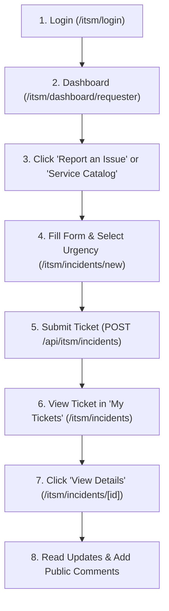

# AuthClaw ITSM — Requester Portal Change Review & Analysis

## Executive Summary
This document provides a beginner-friendly, evidence-based review of the **Requester Portal** in the AuthClaw ITSM application. It compares the state of the codebase before and after recent enhancements, details every changed file, evaluates safety and backend connectivity, and outlines recommendations for future work.

---

## 1. Original Requester Portal State (Before Changes)

### A. Existed Pages & Routes
- **`/itsm/login`**: Login page for ITSM users.
- **`/itsm/dashboard/requester`**: Self-service dashboard layout featuring ticket counter stats (active tickets, resolved tickets, avg resolution time), fast request links, and knowledge suggestions.
- **`/itsm/incidents/new`**: Issue report form allowing requesters to submit tickets.

### B. Sidebar Items (Original)
- **Dashboard** (`/itsm/dashboard`)
- **Report an Issue** (`/itsm/incidents/new`)

### C. Limitations & Missing Views Before Changes
- Attempts to visit `/itsm/incidents` (Ticket List) or `/itsm/incidents/[id]` (Ticket Details) automatically redirected requesters back to `/itsm/incidents/new`.
- Clicking "Service Catalog" or "Knowledge Base" in the sidebar showed placeholder screens ("Roadmap / Upcoming Phase").
- `urgency` defaulted to `MEDIUM` on the backend, meaning requesters were not required to choose urgency before submitting an incident.

---

## 2. Comprehensive Inventory of Changes Made

| File Path | What the File Does | Why It Was Changed | Type of Change | Exact Route / Surface | Backend API Used |
| :--- | :--- | :--- | :--- | :--- | :--- |
| [`backend/app/schemas/itsm_incidents.py`](file:///c:/Users/DELL/Downloads/AuthClaw_Align-master/AuthClaw_Align-master/backend/app/schemas/itsm_incidents.py) | Pydantic schema for incident creation requests. | Made `urgency` default to `None` instead of `MEDIUM` so urgency selection can be enforced. | API & Data Contract | `POST /v1/itsm/incidents` | N/A |
| [`backend/app/api/v1/endpoints/itsm_incidents.py`](file:///c:/Users/DELL/Downloads/AuthClaw_Align-master/AuthClaw_Align-master/backend/app/api/v1/endpoints/itsm_incidents.py) | FastAPI endpoints for creating, listing, viewing, updating, assigning, and commenting on incidents. | 1. Added HTTP 400 Bad Request validation if `urgency` is omitted. 2. Scoped ticket list, detail view, and activities for `REQUESTER` role so requesters can ONLY access their own tickets and public comments. 3. Stripped internal notes from requester activity responses. | API Enforcement & Access Control | `/v1/itsm/incidents/*` | PostgreSQL DB via SQLAlchemy |
| [`console/src/lib/itsm-format.ts`](file:///c:/Users/DELL/Downloads/AuthClaw_Align-master/AuthClaw_Align-master/console/src/lib/itsm-format.ts) | Helper utilities for formatting timestamps, priorities, and status badges. | Added null-safety checks (`if (!iso) return "—"`) to prevent React rendering crashes when timestamp fields are `null` or string formatting fails. | UI Helper Fix | Utility Function | N/A |
| [`console/src/components/console-shell.tsx`](file:///c:/Users/DELL/Downloads/AuthClaw_Align-master/AuthClaw_Align-master/console/src/components/console-shell.tsx) | Main shell component defining header, product branding, user profile menu, and sidebar navigation. | 1. Updated subtitle branding from "SERVICE MANAGEMENT" to "ITSM". 2. Added **My Tickets**, **Service Catalog**, and **Knowledge Base** to the sidebar for `REQUESTER` role. | Shell / Navigation UI | Main Layout Sidebar | `/api/auth/session` |
| [`console/src/app/(console)/itsm/layout.tsx`](file:///c:/Users/DELL/Downloads/AuthClaw_Align-master/AuthClaw_Align-master/console/src/app/(console)/itsm/layout.tsx) | Server-side route layout guard for ITSM pages. | Added `/itsm/incidents`, `/itsm/services`, and `/itsm/knowledge` to allowed paths for `REQUESTER` role to prevent unwanted redirects to dashboard. | Route Security Guard | `/itsm/*` Layout | `/v1/auth/me` |
| [`console/src/app/(console)/itsm/dashboard/requester/page.tsx`](file:///c:/Users/DELL/Downloads/AuthClaw_Align-master/AuthClaw_Align-master/console/src/app/(console)/itsm/dashboard/requester/page.tsx) | Requester self-service dashboard page. | Updated subtitle branding and safe date rendering for active ticket table. | UI Component | `/itsm/dashboard/requester` | `/api/itsm/incidents` |
| [`console/src/app/(console)/itsm/incidents/new/page.tsx`](file:///c:/Users/DELL/Downloads/AuthClaw_Align-master/AuthClaw_Align-master/console/src/app/(console)/itsm/incidents/new/page.tsx) | Create incident form page. | Initialized `urgency` to empty (`""`) and required explicit user selection before form submission. | Form UI & Validation | `/itsm/incidents/new` | `POST /api/itsm/incidents` |
| [`console/src/app/(console)/itsm/incidents/page.tsx`](file:///c:/Users/DELL/Downloads/AuthClaw_Align-master/AuthClaw_Align-master/console/src/app/(console)/itsm/incidents/page.tsx) | Dedicated "My Tickets" listing page. | Replaced redirect with interactive ticket list table, search bar, status filters (All, Open, In Progress, Pending, Resolved, Closed), and "View Details" actions. | API-Connected Page | `/itsm/incidents` | `GET /api/itsm/incidents` |
| [`console/src/app/(console)/itsm/incidents/[id]/page.tsx`](file:///c:/Users/DELL/Downloads/AuthClaw_Align-master/AuthClaw_Align-master/console/src/app/(console)/itsm/incidents/[id]/page.tsx) | Ticket details page. | Added conditional rendering for `isRequester`: shows ticket summary, status, description, resolution summary, and public activity timeline while hiding internal operational buttons (Assign, Change Status, Edit, System Audit). | API-Connected Page & Security Masking | `/itsm/incidents/[id]` | `GET /api/itsm/incidents/[id]`, `GET/POST /api/itsm/incidents/[id]/activities` |
| [`console/src/app/(console)/itsm/services/page.tsx`](file:///c:/Users/DELL/Downloads/AuthClaw_Align-master/AuthClaw_Align-master/console/src/app/(console)/itsm/services/page.tsx) | Service Catalog browsing page. | Replaced placeholder with interactive service catalog (Hardware, Software, Security, General IT) with category filters and "Request Service" actions. | Visual & Pre-filled Navigation | `/itsm/services` | Links to `/itsm/incidents/new` |
| [`console/src/app/(console)/itsm/knowledge/page.tsx`](file:///c:/Users/DELL/Downloads/AuthClaw_Align-master/AuthClaw_Align-master/console/src/app/(console)/itsm/knowledge/page.tsx) | Knowledge Base documentation page. | Replaced placeholder with category filtering, search input, article listing, and interactive step-by-step resolution modal. | Visual & Self-Service UI | `/itsm/knowledge` | Client-side resolution guides |

---

## 3. Current Requester Portal Component Status

| Feature / Surface | Route Path | Implementation Status | Data Source | Safety & Access Level |
| :--- | :--- | :--- | :--- | :--- |
| **Dashboard** | `/itsm/dashboard/requester` | **COMPLETE** | Live Backend API | Safe (shows only requester's active tickets) |
| **My Tickets** | `/itsm/incidents` | **COMPLETE** | Live Backend API | Safe (backend enforces `requester_id = actor_id`) |
| **Report an Issue** | `/itsm/incidents/new` | **COMPLETE** | Live Backend API | Safe (enforces required urgency selection) |
| **Service Catalog** | `/itsm/services` | **PARTIAL** | Pre-configured Catalog Items | Safe (pre-fills `/itsm/incidents/new` request form) |
| **Knowledge Base** | `/itsm/knowledge` | **PARTIAL** | Interactive Self-Service Guides | Safe (visual resolution guides & feedback) |
| **Ticket Details** | `/itsm/incidents/[id]` | **COMPLETE** | Live Backend API | Safe (hides internal notes, assignees, and audit cards) |
| **Notifications** | Bell icon (header) | **COMPLETE** | Live Notification Component | Safe |
| **Profile Menu** | Dropdown (header) | **COMPLETE** | Session Context | Safe (logout and user email display) |

---

## 4. Feature Safety & Categorization Analysis

### A. Features That Should Be Kept
- **Identity & Tenant Scoping on Backend**: `backend/app/api/v1/endpoints/itsm_incidents.py` checks `role == "REQUESTER"` and forces `requester_id = actor_id`. This guarantees cross-tenant and cross-user data isolation.
- **Required Urgency Validation**: Prevents incomplete ticket submissions without priority calculation inputs.
- **Requester-Safe Ticket Details View**: Hides operational controls (`Assign`, `Change Status`, `Edit`, internal audit logs) while allowing requesters to view resolution notes and participate in public timeline comments.

### B. Features That Are Visual / Pre-Configured (Not Yet Dynamic DB Backed)
- **Service Catalog Items (`/itsm/services`)**: Provides a curated service list (Hardware, AWS Sandbox, MFA Reset, WiFi). Clicking "Request Service" pre-fills `/itsm/incidents/new`. *Backend DB service catalog entities (`itsm_services`) exist in schema but do not yet have public API endpoints.*
- **Knowledge Base Articles (`/itsm/knowledge`)**: Provides self-service resolution guides (WireGuard VPN, Okta SSO, YubiKey). *Allows immediate self-service troubleshooting without creating unnecessary backend infrastructure.*

### C. Features Shared By Other Roles (MUST NOT BE REMOVED)
- **`ConsoleShell` (`console/src/components/console-shell.tsx`)**: Shared layout shell for all AuthClaw platform roles (`REQUESTER`, `SERVICE_AGENT`, `SERVICE_LEAD`, `PLATFORM_ADMINISTRATOR`, `AUDITOR`).
- **`ActivityTimeline` (`console/src/components/itsm/activity-timeline.tsx`)**: Shared activity component used by both agents and requesters. (Backend filters out `is_internal: true` notes for requesters).

---

## 5. Comprehensive Feature & Route Matrix

| Feature / File / Route | Current Purpose | Keep / Improve / Remove | Reason | Risk Level |
| :--- | :--- | :--- | :--- | :--- |
| `backend/app/api/v1/endpoints/itsm_incidents.py` | Enforces RLS, tenant isolation, and requester scoping. | **Keep** | Essential security layer; prevents requesters from viewing or modifying other users' tickets. | Low |
| `backend/app/schemas/itsm_incidents.py` | Defines request payload contract. | **Keep** | Enables required urgency validation. | Low |
| `console/src/app/(console)/itsm/layout.tsx` | Layout path security guard. | **Keep** | Permits requester navigation to all 5 portal pages. | Low |
| `console/src/components/console-shell.tsx` | App shell and navigation drawer. | **Keep** | Displays consistent branding and 5 requester sidebar links. | Low |
| `console/src/app/(console)/itsm/dashboard/requester/page.tsx` | Self-service dashboard. | **Keep** | Provides KPI stats and quick action banners. | Low |
| `console/src/app/(console)/itsm/incidents/page.tsx` | My Tickets listing. | **Keep** | Interactive ticket list with status filter tabs and search. | Low |
| `console/src/app/(console)/itsm/incidents/new/page.tsx` | Ticket creation form. | **Keep** | Required urgency selector ensures valid priority derivation. | Low |
| `console/src/app/(console)/itsm/incidents/[id]/page.tsx` | Ticket details & discussion. | **Keep** | Shows requester-safe timeline while masking agent controls. | Low |
| `console/src/app/(console)/itsm/services/page.tsx` | Service catalog. | **Improve** | Connect to dynamic `itsm_services` DB endpoints when backend endpoints are introduced. | Low |
| `console/src/app/(console)/itsm/knowledge/page.tsx` | Knowledge base. | **Improve** | Connect to vector search / RAG endpoints when knowledge endpoints are introduced. | Low |

---

## 6. Current Requester User Journey (Step-by-Step)

1. **Login**: Requester authenticates at `/itsm/login` with credentials (e.g., `requester123@gmail.com`).
2. **Dashboard**: Redirected to `/itsm/dashboard/requester` displaying active ticket counters and fast request links.
3. **Initiate Request**: Click **"Report an Issue"** or select a service from **"Service Catalog"**.
4. **Fill Form**: Enter problem title, description, category, and explicitly select **Urgency** (*High*, *Medium*, *Low*).
5. **Submit**: Form POSTs payload to backend. Backend validates urgency and assigns ticket number (e.g., `INC-000016`).
6. **My Tickets**: Requester views submitted ticket in `/itsm/incidents` filtered by status (*New*, *In Progress*, *Resolved*).
7. **Ticket Details**: Requester opens `/itsm/incidents/[id]` to review resolution summary and post public comments in the discussion timeline.

---

## 7. Knowns & Unknowns

### Verified Knowns
- All 5 Requester Portal pages return **HTTP 200 OK**.
- Backend PostgreSQL database correctly stores tickets in table `public.itsm_tickets`.
- Requesters are strictly restricted to viewing and commenting on their own tickets.

### Explicit Unknowns (No Assumptions Made)
- **Dynamic Backend Service Catalog API**: Backend schema defines table `itsm_services`, but public CRUD REST endpoints for `/v1/itsm/services` have not yet been exposed in `backend/app/api/v1/endpoints/`.
- **Knowledge Base RAG API**: RAG vector endpoint `backend/app/api/v1/endpoints/rag.py` exists for general governance compliance, but has not yet been connected to ITSM knowledge article queries.

---

## 8. Closing Summary & Recommendations

### A. What is Safe to Keep
- All backend role-scoping and urgency validation in `itsm_incidents.py`.
- The 5 requester pages (`/itsm/dashboard`, `/itsm/incidents`, `/itsm/incidents/new`, `/itsm/services`, `/itsm/knowledge`).
- Requester-safe detail view in `incidents/[id]/page.tsx`.

### B. What Needs Improvement (Future Phases)
- Service catalog form pre-filling can expand to support custom dynamic fields per service type.
- Knowledge base search can integrate with full-text or vector search when backend endpoints are ready.

### C. What is Missing
- Reopen / Confirm Resolution buttons on resolved tickets (awaiting backend status transition permissions for `REQUESTER`).

### D. What Must Not Be Touched
- Shared shell navigation framework (`ConsoleShell`).
- Operational role portals (`SERVICE_AGENT`, `SERVICE_LEAD`, `PLATFORM_ADMINISTRATOR`).
- Multi-tenant RLS policies and authentication middleware.

### E. Recommended Next Small Step
- Run container stack and perform end-to-end browser walkthrough testing of ticket creation and commenting.
